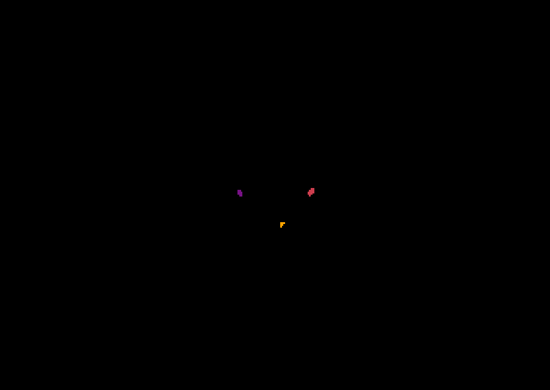

<p align="center">
  
</p>

<h1 align="center">CIT168 parcellation of human subcortical brain nuclei</h1>

<p align="center">
  A subject-specific parcellation of 16 bilateral subcortical nuclei from a single whole-head T1-weighted image.
</p>

<p align="center">
  <a href="https://github.com/brainlife/abcd-spec"></a>
  <a href="https://doi.org/10.25663/brainlife.app.449"></a>
  <a href="LICENSE"></a>
</p>

## At a glance

<!-- brainlife-app:begin (generated from the App manifest; edit the manifest, not this block) -->

> **Generates a subject-specific parcellation of subcortical nuclei by registering the CIT168 probabilistic atlas (Pauli et al. 2018) to a T1-weighted image with atlaskit and thresholding the warped probabilities at 0.5.**

Registers the CIT168 700 um T1w template to the subject T1 with the atlaskit tmp2ind_T1 script, warps the lateralised CIT168 probabilistic atlas into subject space and converts it to a deterministic parcellation (probability above 0.5). Use it to obtain subcortical nuclei ROIs (for example for tractography or connectomics). Needs a whole-head (not brain-extracted) T1w image.

| | |
|---|---|
| **Inputs** | `neuro/anat/t1w` |
| **Outputs** | `neuro/parcellation/volume` |
| **Container** | `brainlife/atlaskit:1.0` |
| **Resources** | 8 CPUs · 28 GB memory · 10 h walltime |
| **Run it** | [doi.org/10.25663/brainlife.app.449](https://doi.org/10.25663/brainlife.app.449) |

#### Inputs

| Input | Datatype | Required | Description |
|---|---|---|---|
| `t1w` | `neuro/anat/t1w` (!brain_extracted) | yes | This is the T1 image which will be have its subcortical regions parcellated and labeled. |

#### Outputs

| Output | Datatype | Description |
|---|---|---|
| `output` | `neuro/parcellation/volume` | This is a 3D, volumetric parcellation of subcortical regions(in nifti format) of the associated input T1 image |

<!-- brainlife-app:end -->

## Running the App

The App registers the CIT168 700 µm T1w template to the subject's T1 with the [atlaskit](https://github.com/jmtyszka/atlaskit/wiki) `tmp2ind_T1.sh` script (ANTs), warps the lateralised CIT168 probabilistic atlas ([Pauli et al. 2018](https://identifiers.org/neurovault.collection:3145)) into subject space, and converts it to a deterministic parcellation with `prob2det.sh` (voxels with probability above 0.5).

### On brainlife.io

Open the App at [doi.org/10.25663/brainlife.app.449](https://doi.org/10.25663/brainlife.app.449), choose a T1-weighted dataset from your project and press **Execute**. The input must be a whole-head image (datasets tagged `brain_extracted` are not accepted), because the CIT168 template it is registered to is not skull-stripped. The parcellation is archived to your project as a `neuro/parcellation/volume` dataset tagged `subcortical`, ready for tractography or connectomics Apps that take ROIs. Any project with T1 data works as a test, for example the [Human Connectome Project 3T](https://brainlife.io/project/5941a225f876b000210c11e5/detail) project.

### Locally

You need [Singularity/Apptainer](https://apptainer.org/) and [`jq`](https://jqlang.github.io/jq/). The App runs inside the [`brainlife/atlaskit:1.0`](https://hub.docker.com/r/brainlife/atlaskit) container, which ships atlaskit, ANTs, FSL and the CIT168 templates (including the [lateralised atlas](https://github.com/brainlife/docker-atlaskit/tree/master/CIT168Atlases)) under `/template`.

1. Clone this repository.
2. Create `config.json` with the path to your T1 (see `config.json_sample`):

   ```json
   {
       "t1": "/input/t1/t1.nii.gz"
   }
   ```

3. Run the App:

   ```bash
   ./main
   ```

Running outside the container needs Python 3.4+, FSL 5.0.9+, ANTs 2.1.0+, atlaskit and the CIT168 templates. Two notes for that case:

- The CIT168 parcellation published on NeuroVault is **not lateralised** (left and right variants of a structure share a label). Lateralise it as described in [issue #2](https://github.com/brainlife/app-CIT168Parc/issues/2), or use the lateralised version shipped in the container.
- atlaskit expects a 4D probabilistic atlas; merge the separate 3D atlas volumes with [`fslmerge`](https://fsl.fmrib.ox.ac.uk/fsl/fslwiki/Fslutils) first.

## Outputs

```text
output/
├── parc.nii.gz   deterministic subcortical parcellation in subject space
├── key.txt       label number → structure name
└── label.json    label names and voxel values (brainlife.io format)
```

Labels (odd = left, even = right):

| Label | Structure | Label | Structure |
|---|---|---|---|
| 0 | background | | |
| 1 | l_putamen | 2 | r_putamen |
| 3 | l_caudate | 4 | r_caudate |
| 5 | l_nucleus_accumbens | 6 | r_nucleus_accumbens |
| 7 | l_extended_amygdala | 8 | r_extended_amygdala |
| 9 | l_external_globus_pallidus | 10 | r_external_globus_pallidus |
| 11 | l_internal_globus_pallidus | 12 | r_internal_globus_pallidus |
| 13 | l_substantia_nigra_pars_compacta | 14 | r_substantia_nigra_pars_compacta |
| 15 | l_red_nucleus | 16 | r_red_nucleus |
| 17 | l_substantia_nigra_pars_reticulata | 18 | r_substantia_nigra_pars_reticulata |
| 19 | l_parabrachial_pigmented_nucleus | 20 | r_parabrachial_pigmented_nucleus |
| 21 | l_ventral_tegmental_area | 22 | r_ventral_tegmental_area |
| 23 | l_ventral_pallidum | 24 | r_ventral_pallidum |
| 25 | l_habenular_nucleus | 26 | r_habenular_nucleus |
| 27 | l_hypothalamus | 28 | r_hypothalamus |
| 29 | l_mamillary_nucleus | 30 | r_mamillary_nucleus |
| 31 | l_subthalamic_nucleus | 32 | r_subthalamic_nucleus |

## Troubleshooting

- **Poor registration or a misplaced parcellation**: use a whole-head T1; a skull-stripped image does not match the non-skull-stripped CIT168 template.
- **Unlateralised labels when running locally**: see the note on lateralisation above.

## Citing

> [!TIP]
> If you use this App in your work, please cite the App, the software it builds on and brainlife.io (below). GitHub's **Cite this repository** button gives the App citation in APA and BibTeX.

- Pauli W, Nili A, Tyszka J. A high-resolution probabilistic in vivo atlas of human subcortical brain nuclei. *Scientific Data* 5:180063 (2018). [doi:10.1038/sdata.2018.63](https://doi.org/10.1038/sdata.2018.63) ([NeuroVault collection 3145](https://identifiers.org/neurovault.collection:3145))
- atlaskit: tools for working with deterministic and probabilistic anatomic atlas labels. [github.com/jmtyszka/atlaskit](https://github.com/jmtyszka/atlaskit/wiki) [](https://zenodo.org/badge/latestdoi/33556742)
- CIT168 parcellation of human subcortical brain nuclei. brainlife.io App. [doi:10.25663/brainlife.app.449](https://doi.org/10.25663/brainlife.app.449)
- Avesani P. et al. The open diffusion data derivatives. Sci Data 6, 69 (2019). [doi:10.1038/s41597-019-0073-y](https://doi.org/10.1038/s41597-019-0073-y)
- Hayashi S, Caron BA, Heinsfeld AS, et al. brainlife.io: a decentralized and open-source cloud platform to support neuroscience research. *Nature Methods* 21:809–813 (2024). [doi:10.1038/s41592-024-02237-2](https://doi.org/10.1038/s41592-024-02237-2)

## Authors

- Daniel Bullock
- Franco Pestilli (project director)

**Contributors:** Soichi Hayashi

## Funding

[](https://wellcome.org/)
[](https://reporter.nih.gov/project-details/11261037)
[](https://reporter.nih.gov/project-details/11411328)
[](https://reporter.nih.gov/project-details/10262925)
[](https://reporter.nih.gov/project-details/10428625)
[](https://reporter.nih.gov/project-details/10460628)
[](https://reporter.nih.gov/project-details/11140284)
[](https://www.nsf.gov/awardsearch/showAward?AWD_ID=1734853)
[](https://www.nsf.gov/awardsearch/showAward?AWD_ID=2203524)
[](https://www.nsf.gov/awardsearch/showAward?AWD_ID=1636893)
[](https://www.nsf.gov/awardsearch/showAward?AWD_ID=2148729)
[](https://www.nsf.gov/awardsearch/showAward?AWD_ID=1912270)
[](https://www.nsf.gov/awardsearch/showAward?AWD_ID=2148700)
[](https://www.nsf.gov/awardsearch/showAward?AWD_ID=1916518)

<sub>brainlife.io is publicly funded, and acknowledging that support helps keep it running. This App was developed with support from Wellcome, the U.S. National Institutes of Health (including the BRAIN Initiative BRAIN CONNECTS program: The Axonal Projectome EXchange, U24NS140384, and the Center for Mesoscale Connectomics, UM1NS132207) and the U.S. National Science Foundation.</sub>

## License

[MIT](LICENSE). The CIT168 atlas and atlaskit are distributed under their own terms.
